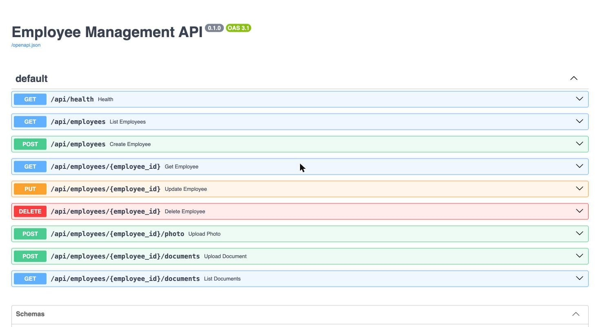
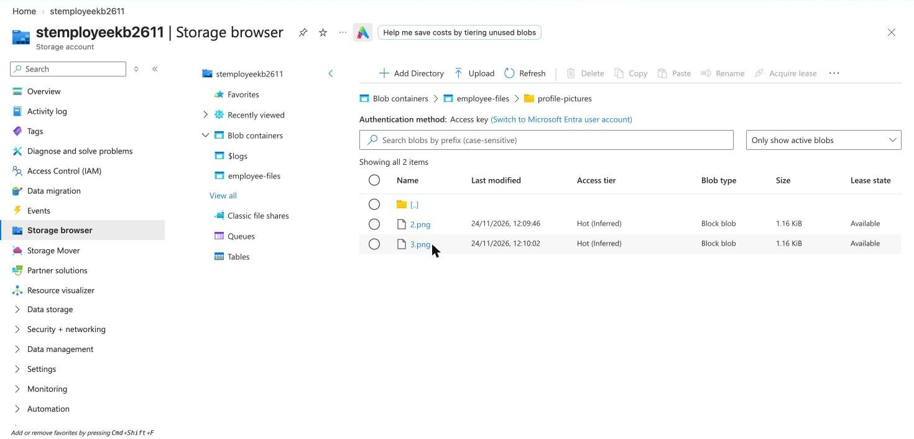
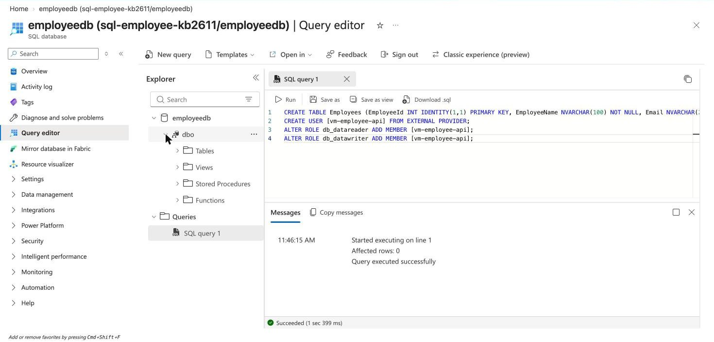
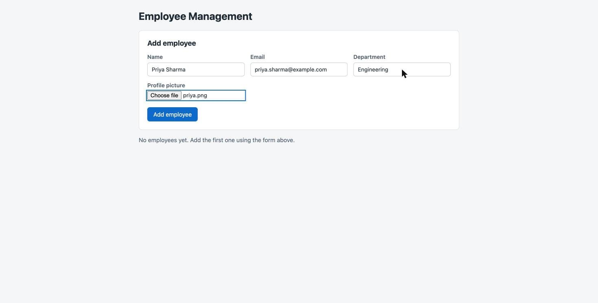
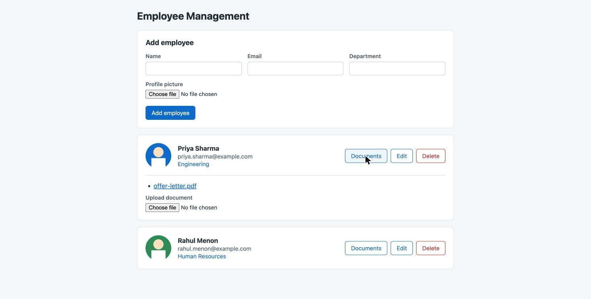
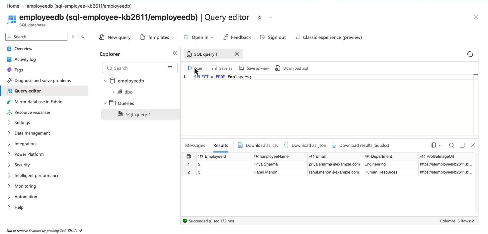

# Employee Management App on Microsoft Azure

A full-stack employee management application deployed on Microsoft Azure: a React frontend, a REST API on an
Azure Virtual Machine, Azure SQL Database for employee data and Azure Blob Storage for profile pictures and
documents.

| | Link |
|---|---|
| Frontend (Azure Static Web Apps) | https://lemon-cliff-011719400.4.azurestaticapps.net |
| API (Azure VM, HTTPS) | https://employee-api-kb2611.centralindia.cloudapp.azure.com/api/health |
| API reference (Swagger UI) | https://employee-api-kb2611.centralindia.cloudapp.azure.com/docs |


## Azure resources (resource group `rg-employee-app`, region Central India)

| Resource | Name | Configuration |
|---|---|---|
| Virtual network | `vnet-employee` | 10.0.0.0/16 |
| Subnets | `snet-app`, `snet-private-endpoints` | 10.0.1.0/24, 10.0.2.0/24 |
| Network security group | `nsg-app` | Associated with `snet-app` |
| Virtual machine | `vm-employee-api` | Ubuntu 24.04, Standard_B2ats_v2, system-assigned managed identity |
| Azure SQL | `sql-employee-kb2611` / `employeedb` | Basic (5 DTU), Microsoft Entra-only authentication, public access disabled |
| Private endpoint | `pe-sql` | In `snet-private-endpoints`, private IP 10.0.2.4 |
| Private DNS zone | `privatelink.database.windows.net` | Linked to `vnet-employee` |
| Storage account | `stemployeekb2611` | StorageV2, LRS, HTTPS only, TLS 1.2, anonymous access disabled |
| Blob container | `employee-files` | Private |
| Static Web App | `swa-employee` | Deployed from this repository with GitHub Actions |

## Task 1 – Azure Virtual Machine: backend deployment

| Requirement | What was done |
|---|---|
| Create an Azure VM | `vm-employee-api`, Ubuntu 24.04, Standard_B2ats_v2, in `snet-app` |
| Install runtime and hosting components | Python 3.12 + virtual environment, Nginx, Microsoft ODBC Driver 18 for SQL Server |
| Deploy the Web API | Run by Uvicorn as the systemd service `employee-api` (starts at boot, restarts on failure) |
| Configure a hosting mechanism | Nginx reverse proxy on ports 80/443 → `127.0.0.1:8000` |
| API accessible over HTTPS | DNS label on the public IP, Let's Encrypt certificate (auto-renewal), HTTP redirected to HTTPS |




## Task 2 – React application: static hosting

| Requirement | What was done |
|---|---|
| Create a React application | [employee-app/frontend](employee-app/frontend) (Vite + React 18) |
| Build for production | `npm run build` → `dist/` (run by GitHub Actions on every push) |
| Deploy with Azure Static Web Apps | `swa-employee`, source GitHub `main`, app location `/employee-app/frontend`, output `dist` |
| Frontend → API communication | `VITE_API_URL` in `.env.production` points to the HTTPS API |
| CORS | API allows only the Static Web App origin; other origins are rejected |


## Task 3 – Azure Blob Storage: file management

| Requirement | What was done |
|---|---|
| Create a storage account | `stemployeekb2611`, LRS, secure transfer required, TLS 1.2, anonymous access not allowed |
| Create a blob container | `employee-files`, access level Private |
| Upload through the API | `POST /api/employees/{id}/photo` and `POST /api/employees/{id}/documents` |
| Store pictures and documents | `profile-pictures/<EmployeeId>.<ext>` and `documents/<EmployeeId>/<file name>` |
| Secure access to files | Private container; API uses the VM's managed identity (Storage Blob Data Contributor, no keys); browser gets a read-only SAS link valid 60 minutes |



## Task 4 – Azure SQL Database: database setup

| Requirement | What was done |
|---|---|
| Create an Azure SQL Database | Server `sql-employee-kb2611`, database `employeedb` (Basic tier, 5 DTU) |
| Employee table | `EmployeeId` (identity PK), `EmployeeName`, `Email` (unique), `Department`, `ProfileImageUrl` – [schema.sql](employee-app/database/schema.sql) |
| Connection from the API | ODBC Driver 18, `Encrypt=yes`, VM managed identity (no password); identity has `db_datareader` and `db_datawriter` only |
| CRUD operations | `GET/POST /api/employees`, `GET/PUT/DELETE /api/employees/{id}` |



## Task 5 – Azure networking and security

| Requirement | What was done |
|---|---|
| Virtual network | `vnet-employee` 10.0.0.0/16 |
| Subnets | `snet-app` 10.0.1.0/24 (VM), `snet-private-endpoints` 10.0.2.0/24 (private endpoint) |
| Network security group | `nsg-app` associated with `snet-app` |
| Only required inbound traffic | 443 (API), 80 (certificate validation + redirect to HTTPS), 22 from the administrator's IP only; everything else denied |
| HTTPS | Let's Encrypt certificate on Nginx; Static Web Apps and Blob Storage are HTTPS only |
| VM → SQL securely | Private endpoint (10.0.2.4), SQL public access disabled, TLS, managed identity authentication |
| Private Endpoint + Private DNS | Zone `privatelink.database.windows.net` linked to the VNet resolves the SQL server name to 10.0.2.4 inside the VNet |

## Task 6 – Application integration

| Step | What happens |
|---|---|
| 1. User opens the React application | Static Web App loads the employee list from the API |
| 2. User enters employee details | Add employee form |
| 3. React sends a request to the API | `POST /api/employees` over HTTPS |
| 4. API saves the employee in Azure SQL | Row in `Employees` |
| 5. User uploads a profile picture | File chosen in the same form |
| 6. API uploads the image to Blob Storage | `profile-pictures/<EmployeeId>.png` |
| 7. Image URL associated with the employee | `ProfileImageUrl` column |
| 8. React shows the employee and picture | Picture loaded from Blob Storage with a SAS link |








## Repository layout

```
employee-app/
  backend/     API (main.py, database.py, models.py, schemas.py, storage.py)
  frontend/    React application
  database/    schema.sql
  deploy/      Nginx site config and systemd unit used on the VM
docs/images/   Screenshots used in this README
.github/       Static Web Apps deployment workflow
```

## Demo

https://lemon-cliff-011719400.4.azurestaticapps.net
