# Employee Management App on Microsoft Azure

A full-stack employee management application deployed on Microsoft Azure: a React frontend, a REST API on an
Azure Virtual Machine, Azure SQL Database for employee data and Azure Blob Storage for profile pictures and
documents.

| | Link |
|---|---|
| Frontend (Azure Static Web Apps) | https://lemon-cliff-011719400.4.azurestaticapps.net |
| API (Azure VM, HTTPS) | https://employee-api-kb2611.centralindia.cloudapp.azure.com/api/health |
| API reference (Swagger UI) | https://employee-api-kb2611.centralindia.cloudapp.azure.com/docs |

> **Note on the backend technology.** The task describes a .NET Web API; this implementation uses
> **Python (FastAPI)** for the API. All Azure services and steps are the same; on the
> VM, Nginx + Uvicorn takes the place of IIS + Kestrel. See [docs/01-architecture-and-design.md](docs/01-architecture-and-design.md).

Screenshots below have the account email, subscription ID, object IDs and the administrator's IP address
blacked out.

## Architecture

```
 Browser ──HTTPS──> Azure Static Web Apps (React build)
    │
    └──HTTPS 443──> Public IP + DNS name ──> NSG (443/80, SSH from admin IP only)
                                               │
                     ┌─────────────── VNet 10.0.0.0/16 ───────────────────────────┐
                     │ snet-app 10.0.1.0/24                                       │
                     │   Ubuntu VM: Nginx (TLS) -> Uvicorn/FastAPI (127.0.0.1:8000)│
                     │        │ managed identity                                  │
                     │        ▼                                                   │
                     │ snet-private-endpoints 10.0.2.0/24                         │
                     │   Private Endpoint 10.0.2.4 ──> Azure SQL Database         │
                     │   Private DNS zone privatelink.database.windows.net        │
                     └────────────────────────────────────────────────────────────┘
    VM ──HTTPS + managed identity──> Blob Storage (private container "employee-files")
    Browser ──HTTPS + read-only SAS (60 min)──> Blob Storage (to show pictures / open documents)
```

## Azure resources (resource group `rg-employee-app`, region Central India)

| Resource | Name | Configuration |
|---|---|---|
| Virtual network | `vnet-employee` | 10.0.0.0/16 |
| Subnets | `snet-app`, `snet-private-endpoints` | 10.0.1.0/24, 10.0.2.0/24 |
| Network security group | `nsg-app` | Associated with `snet-app` |
| Virtual machine | `vm-employee-api` | Ubuntu 24.04, Standard_B2ats_v2, system-assigned managed identity |
| Azure SQL | `sql-employee-kb2611` / `employeedb` | Serverless free offer, Microsoft Entra-only authentication, public access disabled |
| Private endpoint | `pe-sql` | In `snet-private-endpoints`, private IP 10.0.2.4 |
| Private DNS zone | `privatelink.database.windows.net` | Linked to `vnet-employee` |
| Storage account | `stemployeekb2611` | StorageV2, LRS, HTTPS only, TLS 1.2, anonymous access disabled |
| Blob container | `employee-files` | Private |
| Static Web App | `swa-employee` | Free plan, deployed from this repository with GitHub Actions |

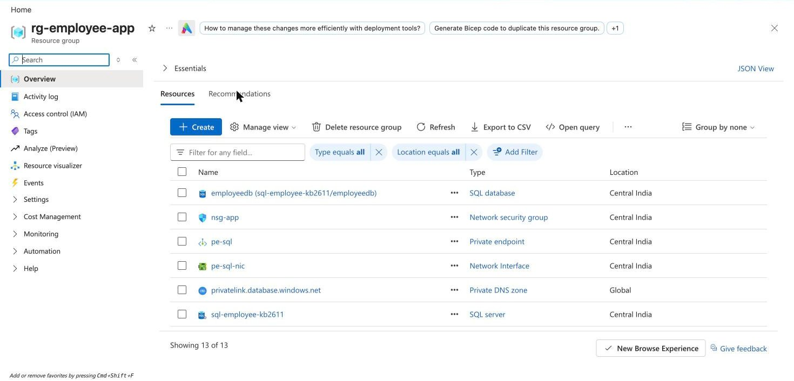

---

## Task 1 – Azure Virtual Machine: backend deployment

| Requirement | What was done |
|---|---|
| Create an Azure VM | `vm-employee-api`, Ubuntu 24.04, Standard_B2ats_v2, in `snet-app`, no NIC-level NSG (the subnet NSG applies) |
| Install runtime and hosting components | Python 3.12 + virtual environment, Nginx, Microsoft ODBC Driver 18 for SQL Server |
| Deploy the Web API | Code in `/home/azureuser/employee-app/backend`, run by Uvicorn as the systemd service `employee-api` (starts at boot, restarts on failure) |
| Configure a hosting mechanism | Nginx reverse proxy on ports 80/443 → `127.0.0.1:8000` ([config](employee-app/deploy/nginx-employee-api.conf), [service](employee-app/deploy/employee-api.service)) |
| API accessible over HTTPS | DNS label `employee-api-kb2611.centralindia.cloudapp.azure.com` on the public IP, Let's Encrypt certificate via certbot (auto-renewal), HTTP redirected to HTTPS |

VM size and image:

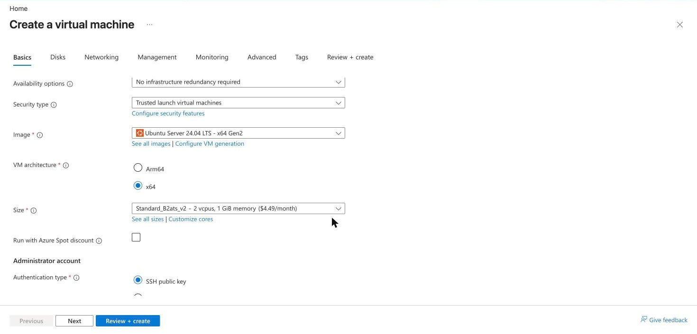

VM placed in the VNet subnet, protected by the subnet NSG:

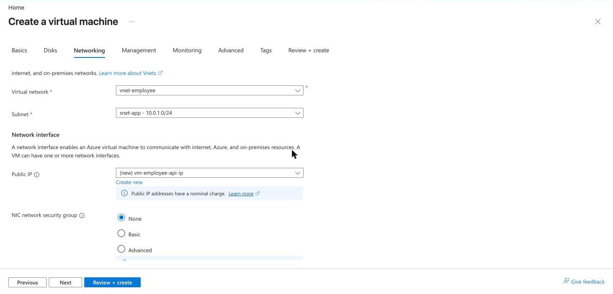

Running VM:

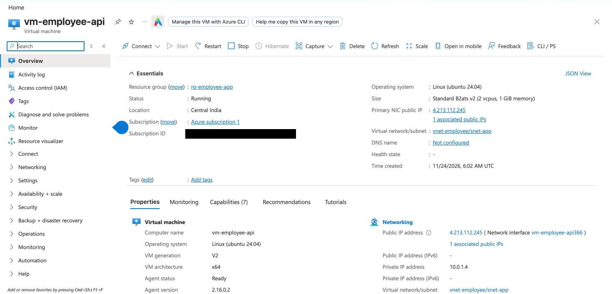

API served over HTTPS:


## Task 2 – React application: static hosting

| Requirement | What was done |
|---|---|
| Create a React application | [employee-app/frontend](employee-app/frontend) (Vite + React 18, no extra libraries) |
| Build for production | `npm run build` → `dist/` (run by GitHub Actions on every push) |
| Deploy with Azure Static Web Apps | `swa-employee`, Free plan, source GitHub `main`, app location `/employee-app/frontend`, output `dist` |
| Frontend → API communication | `VITE_API_URL` in [.env.production](employee-app/frontend/.env.production) points to the HTTPS API |
| CORS | API allows only the Static Web App origin (`ALLOWED_ORIGINS`, FastAPI `CORSMiddleware`); other origins get no `Access-Control-Allow-Origin` header |

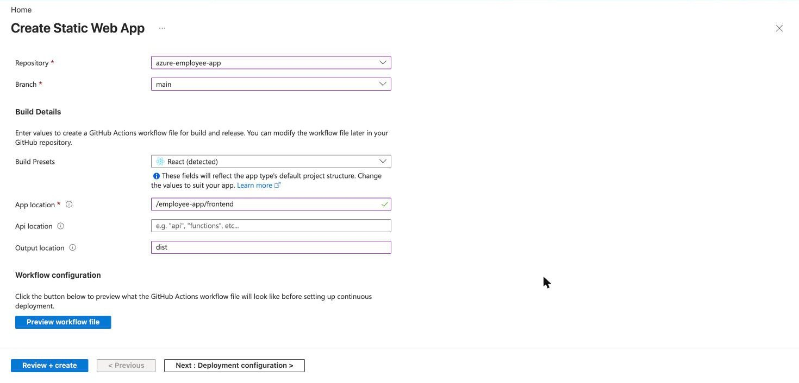

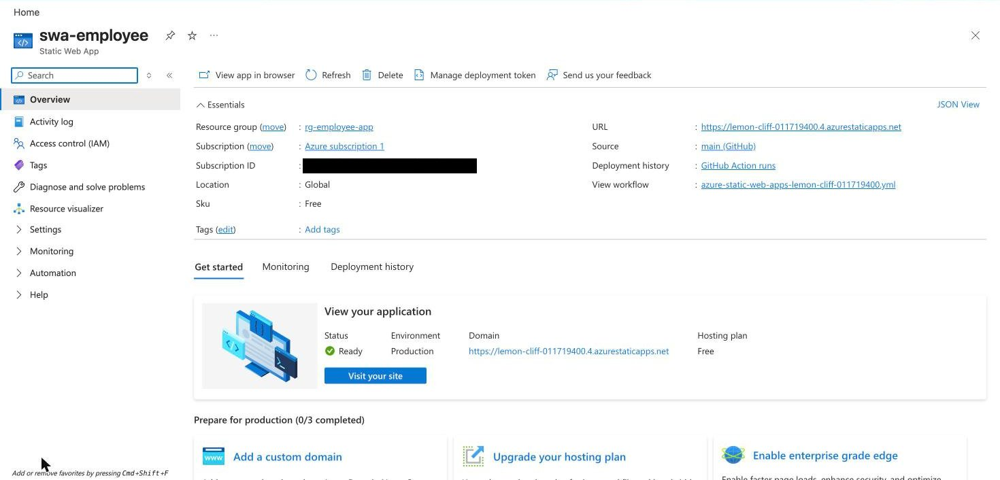

## Task 3 – Azure Blob Storage: file management

| Requirement | What was done |
|---|---|
| Create a storage account | `stemployeekb2611`, Standard LRS, secure transfer required, TLS 1.2, anonymous access not allowed |
| Create a blob container | `employee-files`, access level Private |
| Upload through the API | `POST /api/employees/{id}/photo` (images, max 5 MB) and `POST /api/employees/{id}/documents` |
| Store pictures and documents | `profile-pictures/<EmployeeId>.<ext>` and `documents/<EmployeeId>/<file name>` |

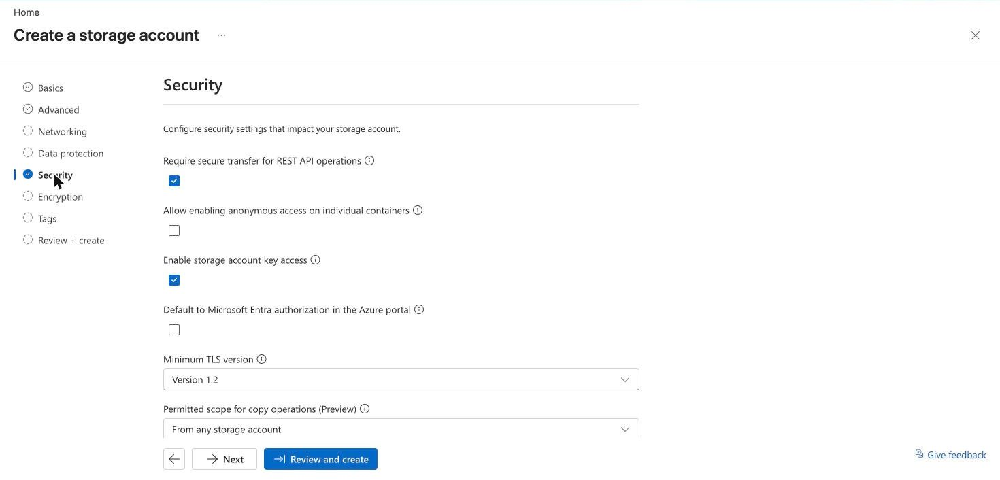

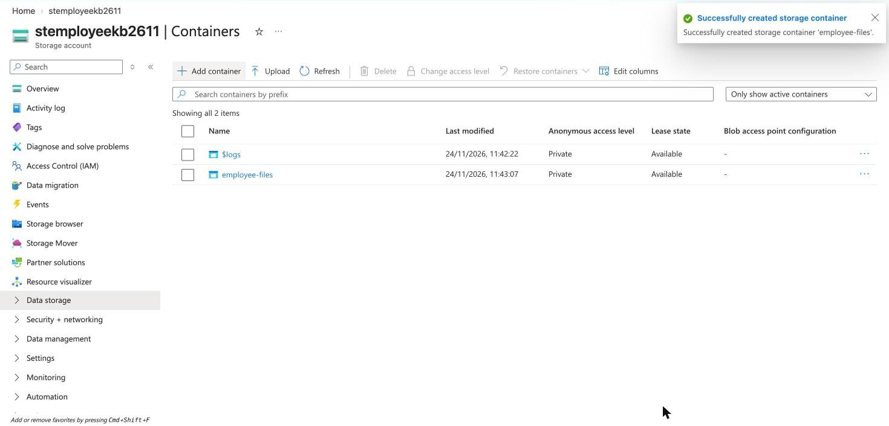


**How access to uploaded files is secured**

- The container is private and anonymous blob access is disabled on the whole account – a blob URL without a
  token is refused.
- The API reaches storage with the VM's **managed identity** (role *Storage Blob Data Contributor* on the
  account). No account key or connection string is stored on the VM.
- The browser gets a **user delegation SAS** URL: read-only, for one blob, valid 60 minutes, signed with the
  managed identity instead of an account key.
- HTTPS only, minimum TLS 1.2, encryption at rest by default.

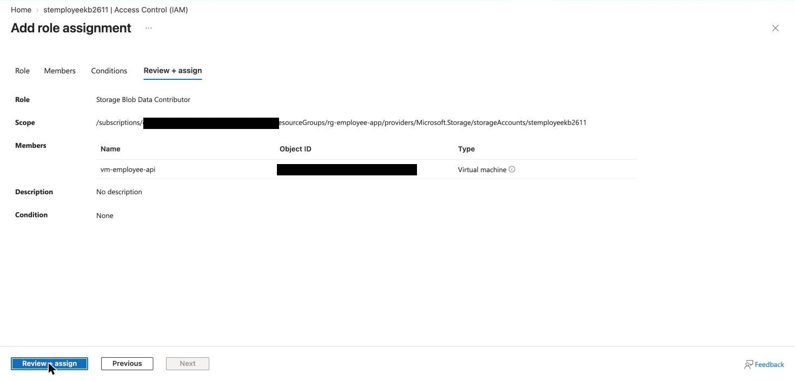

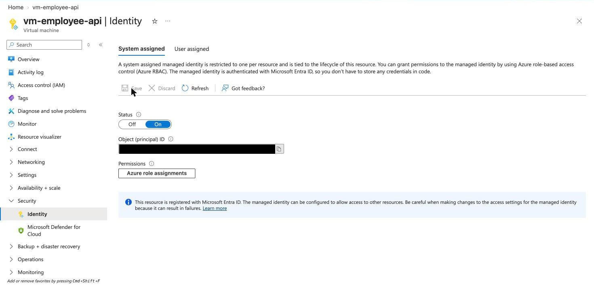

## Task 4 – Azure SQL Database: database setup

| Requirement | What was done |
|---|---|
| Create an Azure SQL Database | Server `sql-employee-kb2611`, database `employeedb`, serverless free offer (auto-pause when the free limit is reached) |
| Employee table | `EmployeeId` (identity PK), `EmployeeName`, `Email` (unique), `Department`, `ProfileImageUrl` – [schema.sql](employee-app/database/schema.sql) |
| Connection from the API | SQLAlchemy + ODBC Driver 18, `Encrypt=yes`, `Authentication=ActiveDirectoryMsi` (managed identity, no password) |
| CRUD operations | `GET/POST /api/employees`, `GET/PUT/DELETE /api/employees/{id}` |

Microsoft Entra-only authentication (no SQL password exists):

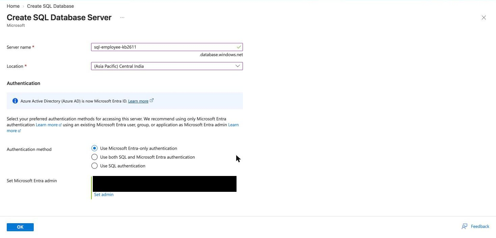

Free offer – estimated cost 0.00 USD:

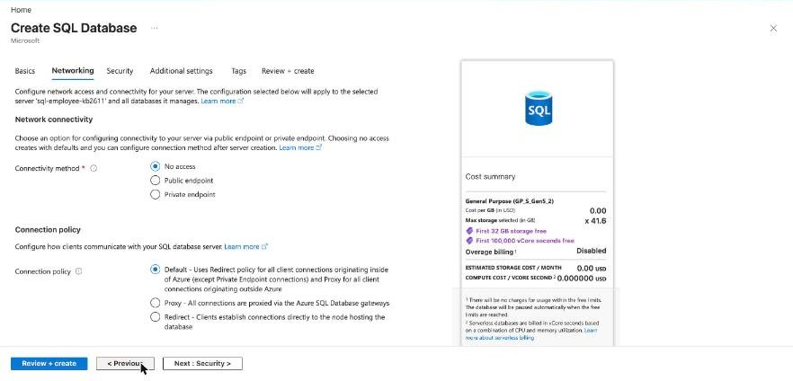

Table created and the VM's managed identity added as a database user with read/write roles only:


## Task 5 – Azure networking and security

| Requirement | What was done |
|---|---|
| Virtual network | `vnet-employee` 10.0.0.0/16 |
| Subnets | `snet-app` 10.0.1.0/24 (VM), `snet-private-endpoints` 10.0.2.0/24 (private endpoint) |
| Network security group | `nsg-app` associated with `snet-app` |
| Only required inbound traffic | 443 (API), 80 (certificate validation + redirect to HTTPS), 22 from the administrator's IP only; everything else denied by `DenyAllInBound` |
| HTTPS | Let's Encrypt certificate on Nginx; Static Web Apps and Blob Storage are HTTPS only |

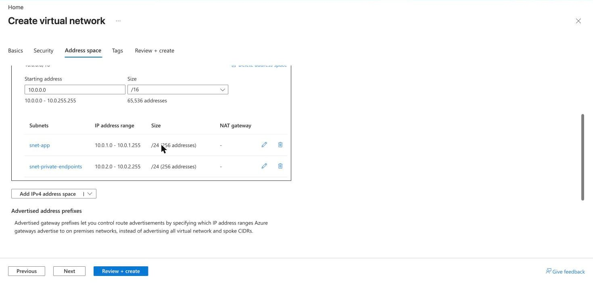

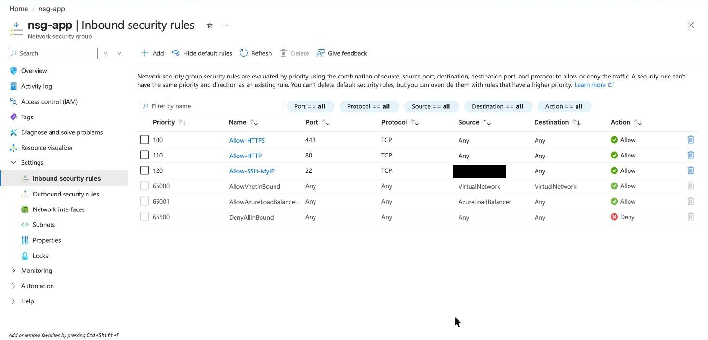

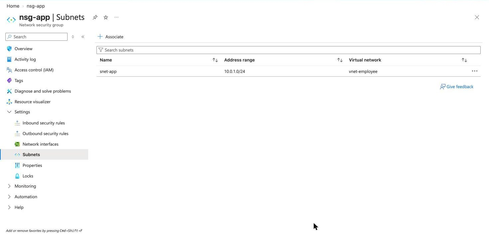

**How the VM communicates securely with Azure SQL**

1. A **private endpoint** gives the SQL server a private IP (10.0.2.4) inside the VNet. Traffic from the VM
   stays on the Microsoft network and never uses the public internet.
2. **Public network access on the SQL server is disabled** – only connections through the private endpoint are
   accepted.
3. The connection is **TLS-encrypted** (`Encrypt=yes`).
4. Authentication uses the VM's **managed identity** with Microsoft Entra – there is no password to leak. The
   identity has only `db_datareader` and `db_datawriter`.

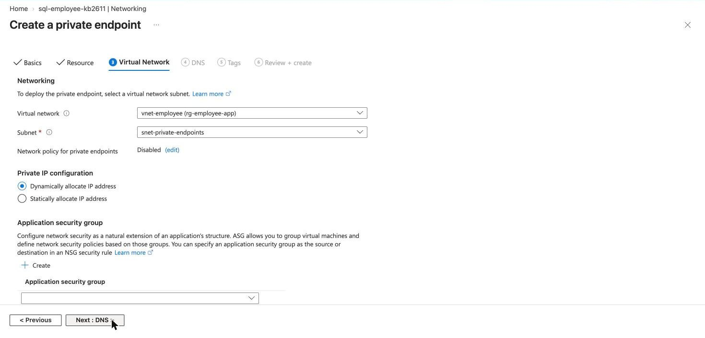

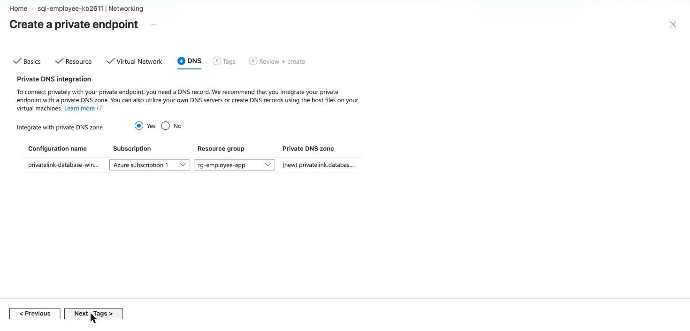

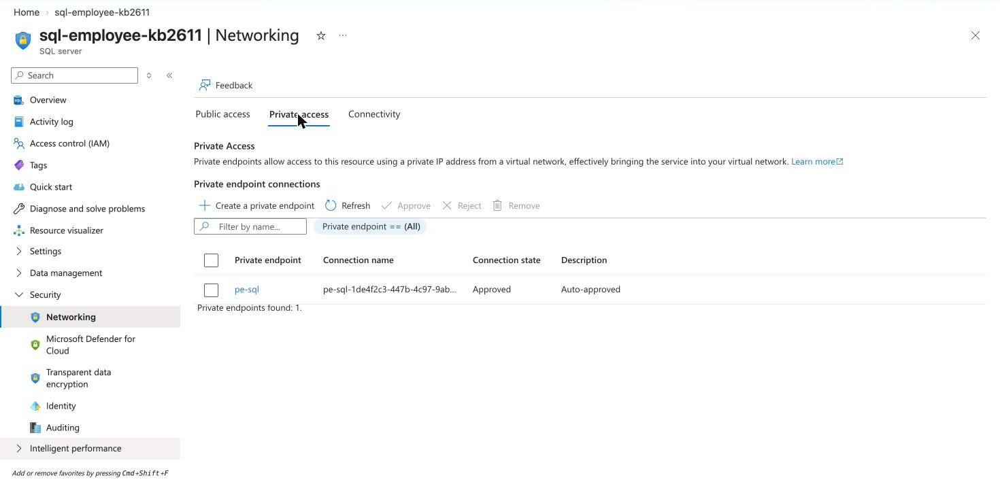

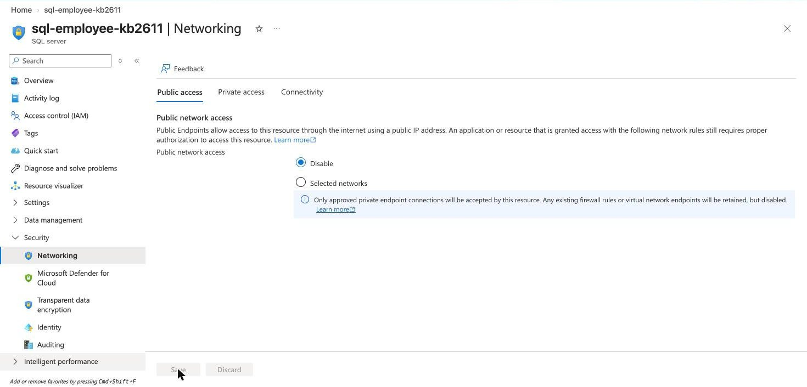

**Private Endpoint and Azure Private DNS**

- A **Private Endpoint** is a network interface with a private IP in a subnet, connected to one specific
  PaaS resource through Azure Private Link. It lets the resource be reached privately and its public endpoint
  be turned off.
- The application still connects to `sql-employee-kb2611.database.windows.net`. Azure answers this name with a
  CNAME to `sql-employee-kb2611.privatelink.database.windows.net`. The **Private DNS zone**
  `privatelink.database.windows.net`, linked to the VNet, holds an A record for that name pointing to
  10.0.2.4. Inside the VNet the normal server name therefore resolves to the private IP – no code or
  connection string change, and the TLS certificate name still matches.

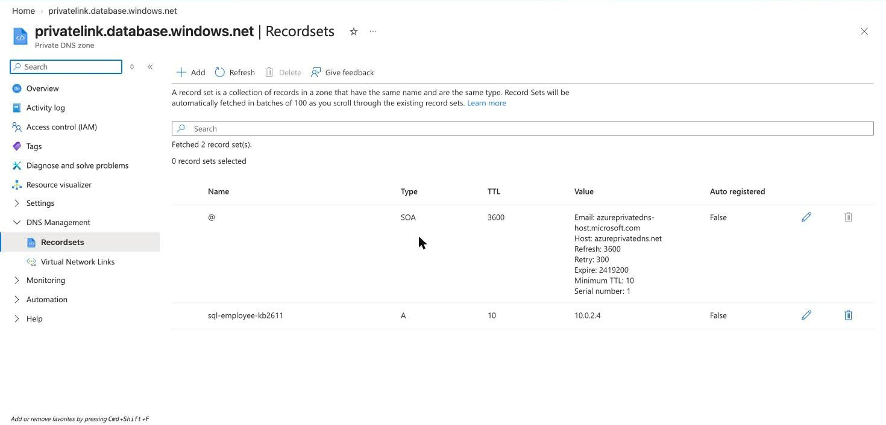

Verified from the VM:

```
$ nslookup sql-employee-kb2611.database.windows.net
Name:    sql-employee-kb2611.privatelink.database.windows.net
Address: 10.0.2.4
```

## Task 6 – Application integration

| Step | Evidence |
|---|---|
| 1. User opens the React application | Static Web App URL above |
| 2. User enters employee details | Add employee form |
| 3. React sends a request to the API | `POST /api/employees` (JSON, HTTPS, CORS) |
| 4. API saves the employee in Azure SQL | Row in `Employees` |
| 5. User uploads a profile picture | File chosen in the same form |
| 6. API uploads the image to Blob Storage | `profile-pictures/<EmployeeId>.png` |
| 7. Image URL associated with the employee | `ProfileImageUrl` column |
| 8. React shows the employee and picture | Picture loaded from Blob Storage with a SAS URL |


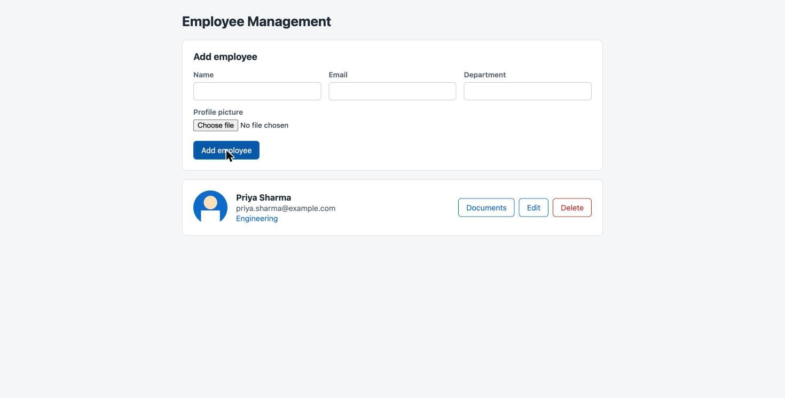


---

## Repository layout

```
employee-app/
  backend/     FastAPI application (main.py, database.py, models.py, schemas.py, storage.py)
  frontend/    React application
  database/    schema.sql
  deploy/      Nginx site config and systemd unit used on the VM
docs/          Design, deployment guides (CLI and portal), walkthrough, Q&A, cost notes
.github/       Static Web Apps deployment workflow
```

## Documentation

- [01 – Architecture and design](docs/01-architecture-and-design.md)
- [02 – Deployment guide (Azure CLI)](docs/02-azure-deployment-guide.md)
- [03 – Application walkthrough](docs/03-application-walkthrough.md)
- [04 – Questions and answers](docs/04-evaluator-questions.md)
- [05 – Prerequisites, cost and free account](docs/05-prerequisites-cost-and-free-account.md)
- [06 – Deployment guide (Azure portal)](docs/06-portal-deployment-guide.md)

## Run locally

See [employee-app/README.md](employee-app/README.md). With `SQL_SERVER` empty the API uses a local SQLite file.
